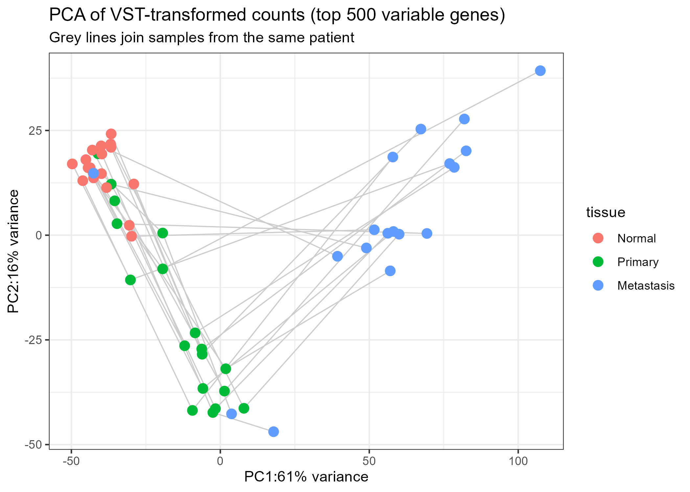
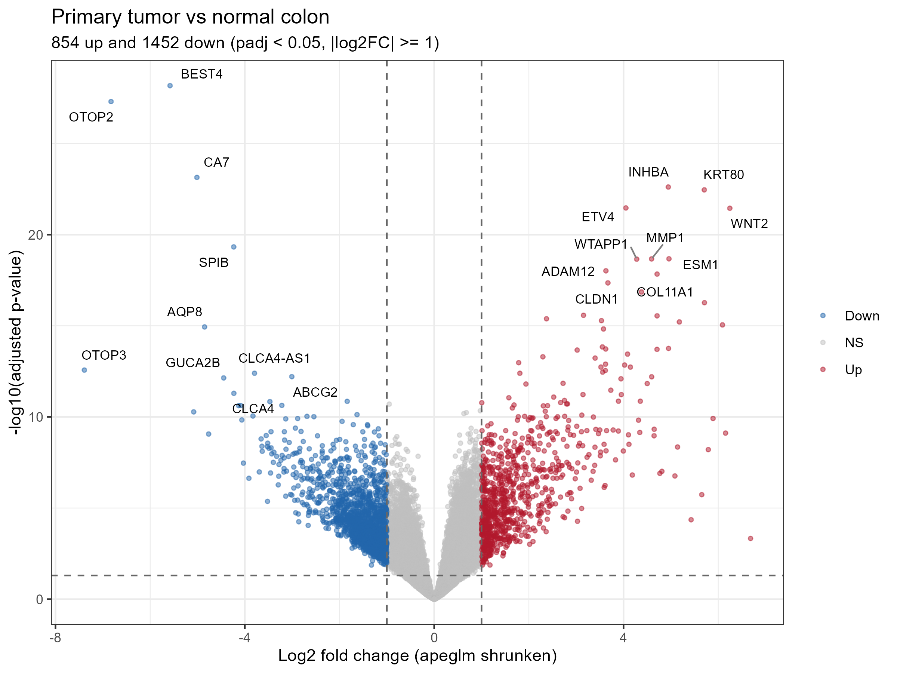
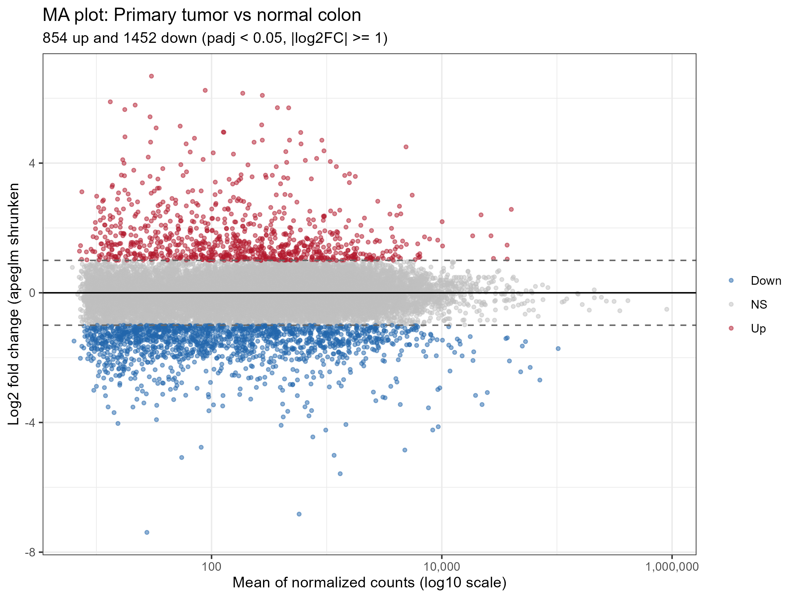
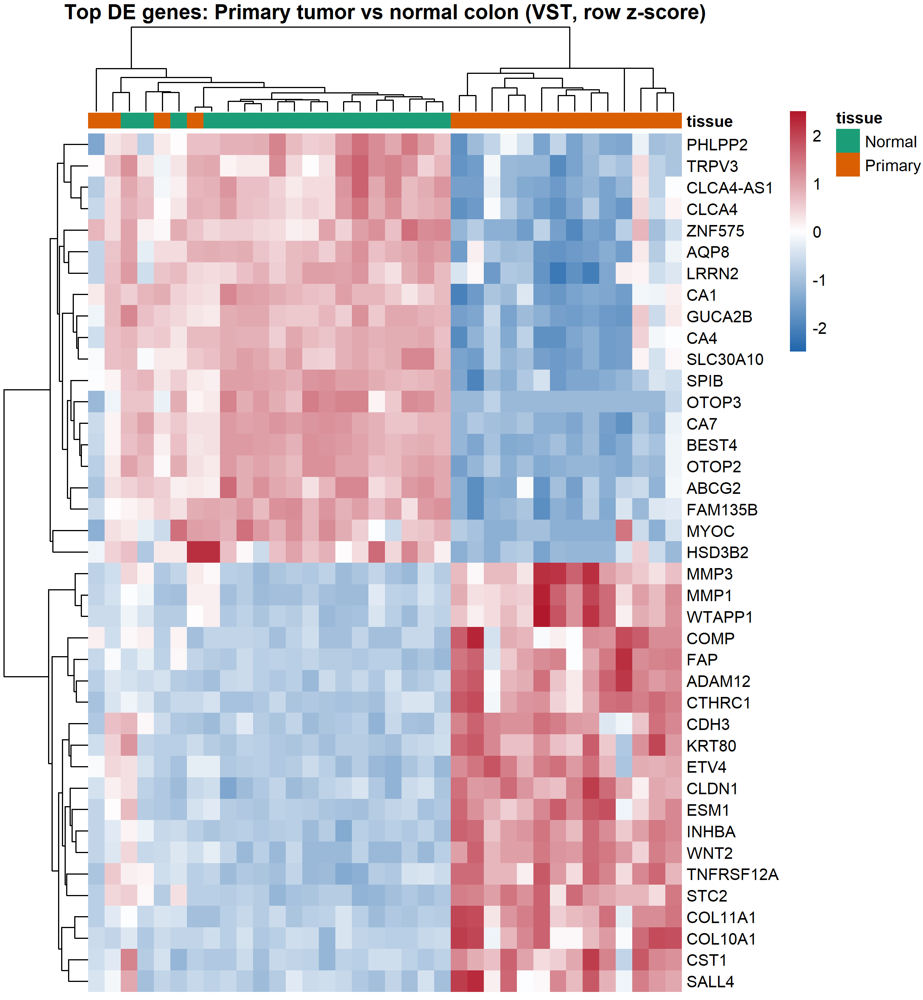
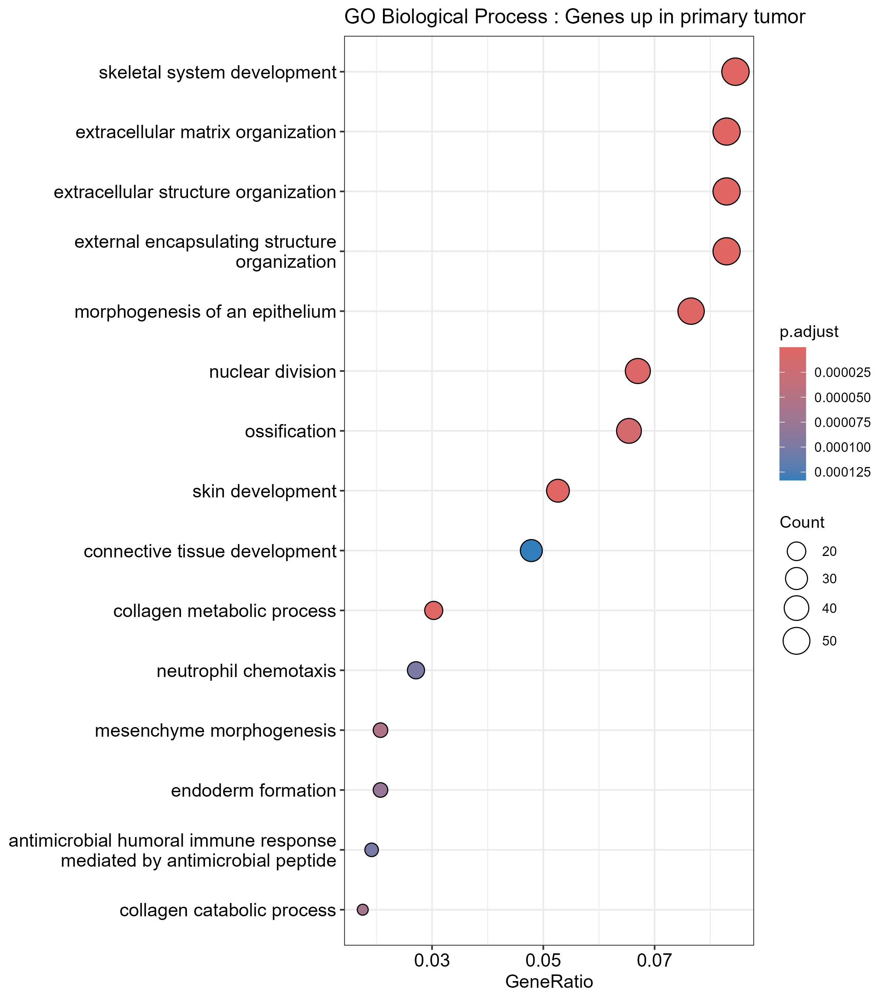
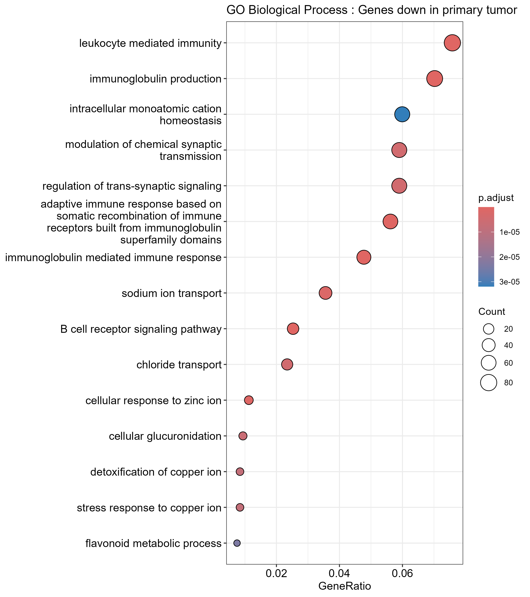

# rnaseq-colorectal-cancer-deseq2

Differential expression and functional enrichment analysis of colorectal cancer RNA-seq data (GSE50760) with DESeq2, using a paired design: normal colon, primary tumour and liver metastasis from the same 18 patients.

> **Status:** analysis complete.

## Key findings

- **Primary tumour vs normal colon is the cleanest contrast:** 854 genes up and 1,452 down (adjusted p < 0.05, |log2FC| ≥ 1).
- **Down-regulated genes** are typical of differentiated colonic epithelium (e.g. *BEST4*, *OTOP2*, *CA7*, *AQP8*, *GUCA2B*). **Up-regulated genes** are enriched in extracellular matrix and collagen organisation (e.g. *MMP1*, *MMP3*, *COL11A1*, *FAP*) and cell division.
- The strongest enrichment among down-regulated genes is immunoglobulin production and B-cell biology. This likely reflects a different immune-cell composition between normal mucosa and tumour, not only tumour-intrinsic regulation.
- **Contrasts involving liver metastases are dominated by liver genes** (*ALB*, *APOA1*, *TTR*, ...) because the metastasis biopsies contain liver tissue. They are reported, but they should not be read as metastasis biology (see [Limitations](#limitations)).

## Biological question

Which genes and pathways change from normal colon tissue to primary colorectal tumour, and from primary tumour to liver metastasis?

## Data

- **Dataset:** [GSE50760](https://www.ncbi.nlm.nih.gov/geo/query/acc.cgi?acc=GSE50760) (GEO)
- 54 samples from 18 colorectal cancer patients: normal colon, primary tumour and liver metastasis for each patient
- Illumina HiSeq 2000, paired-end RNA-seq
- Raw counts generated by NCBI (GRCh38.p13, Entrez gene IDs). FPKM values are not used because DESeq2 requires raw counts.
- Raw data are **not** stored in this repository; `scripts/01_download.R` downloads them into `data/raw/`.

## Methods

- **Filtering:** genes with at least 10 counts in at least 18 samples were kept (19,808 genes).
- **Quality control:** library sizes, variance-stabilising transformation (VST), PCA and sample-distance heatmap. No sample was removed.
- **Differential expression:** DESeq2 with a paired design `~ patient + tissue` (reference level: Normal), Wald test and Benjamini-Hochberg adjusted p-values. Log2 fold changes were shrunk with apeglm. Metastasis vs Primary was obtained by re-levelling the reference to Primary.
- **Thresholds:** adjusted p < 0.05 and |log2FC| ≥ 1.
- **Functional enrichment:** over-representation analysis of GO Biological Process terms with `clusterProfiler::enrichGO`, run separately for up- and down-regulated genes of Primary vs Normal. The universe was the 19,808 tested genes. Redundant terms were reduced with `simplify()` (cutoff 0.7).

### Scripts

| Script | Purpose | Main outputs |
|---|---|---|
| `01_download.R` | Download raw counts and GEO sample metadata | `data/raw/`, `data/processed/sample_metadata.csv` |
| `02_exploratory.R` | QC, gene filtering, VST, PCA, sample distances | `data/processed/dds.rds`, QC figures, `results/tables/qc_summary.csv` |
| `03_deseq2.R` | DESeq2 model and three contrasts | `results/tables/DE_*.csv`, dispersion plot |
| `04_visualization.R` | Volcano and MA plots (Primary vs Normal) | volcano and MA figures |
| `05_heatmap.R` | Heatmap of the top DE genes | heatmap figure |
| `06_enrichment.R` | GO Biological Process over-representation | `results/tables/GO_BP_*.csv`, dot plots |

## Results

### Differentially expressed genes

| Contrast | Up | Down |
|---|---|---|
| Primary vs Normal | 854 | 1,452 |
| Metastasis vs Normal | 1,748 | 2,453 |
| Metastasis vs Primary | 655 | 792 |

Full tables: `results/tables/DE_*.csv`.

### Sample structure



PCA of the VST-transformed counts. The first component separates liver-containing metastasis samples from colon samples (see Limitations).

### Primary tumour vs normal colon





The MA plot shows no systematic bias: the cloud is centred on zero across the whole expression range.



Top 20 up- and top 20 down-regulated genes (by adjusted p-value) in the 36 normal and primary samples, VST values scaled per gene.

### Functional enrichment (Primary vs Normal)





- **Up in tumour:** extracellular matrix organisation, collagen metabolism and nuclear division. Terms such as "skeletal system development" or "ossification" are driven by collagen and matrix genes (e.g. *COL11A1*, *COL10A1*, *COMP*), not by bone-related processes.
- **Down in tumour:** immunoglobulin production and B-cell receptor signalling, sodium and chloride transport, glucuronidation and metal ion responses.

Full tables: `results/tables/GO_BP_*.csv`.

## Limitations

- **Liver tissue in metastasis samples.** Metastasis biopsies contain liver tissue, so the main source of variation (PC1) and the top genes of both metastasis contrasts are liver genes (*ALB*, *APOA1*, *TTR*, ...). These contrasts mostly measure "liver vs colon", and their enrichment results were not interpreted.
- **Bulk RNA-seq.** Differences reflect both changes within cells and changes in cell composition (more stroma and fewer plasma/B cells and differentiated epithelial cells in tumours). Bulk data cannot separate the two.
- **Heterogeneity among primary tumours.** In the heatmap, 4 of the 18 primary samples cluster with the normal samples, possibly because of low tumour content. No samples were excluded.
- **Single dataset.** 18 patients and no external validation.

## Possible extensions

- Sensitivity analysis excluding metastasis samples with a colon-like profile.
- Cell-type deconvolution to account for tissue composition.
- Gene-set enrichment (GSEA) using the full ranked gene list.

## How to reproduce

The analysis uses R 4.4.1 and Bioconductor 3.19. Package versions are locked with [renv](https://rstudio.github.io/renv/).

```bash
git clone https://github.com/vtablado85/rnaseq-colorectal-cancer-deseq2.git
cd rnaseq-colorectal-cancer-deseq2
```

Open `rnaseq-colorectal-cancer-deseq2.Rproj` in RStudio and restore the environment:

```r
renv::restore()
```

Then run the scripts in order, from `scripts/01_download.R` to `scripts/06_enrichment.R`. Data are not versioned (`data/` is ignored by git); scripts 01 and 02 recreate them.

## Repository structure

```
data/raw/         downloaded data (ignored by git)
data/processed/   intermediate objects (ignored by git)
scripts/          numbered analysis scripts
results/figures/  plots
results/tables/   DE results and enrichment tables
renv.lock         locked package versions
```
